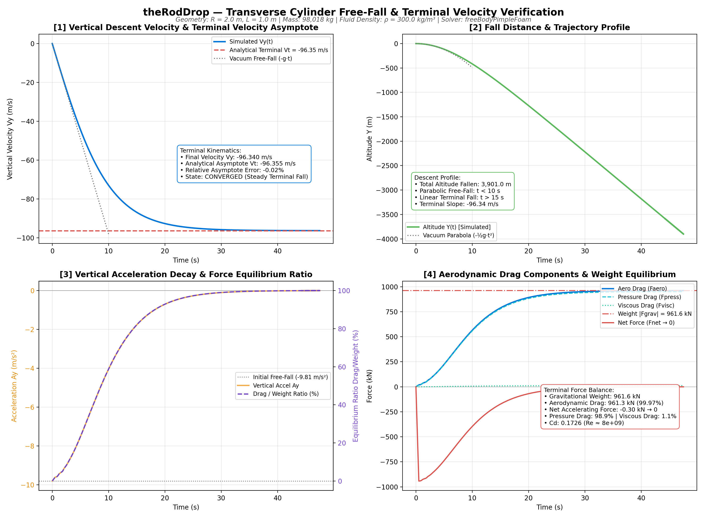
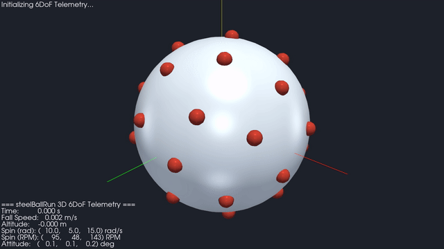
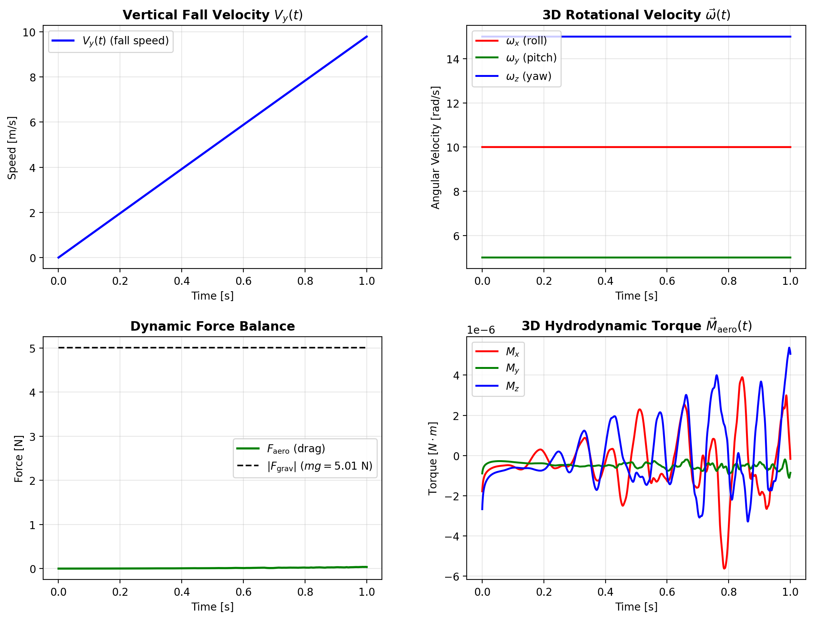
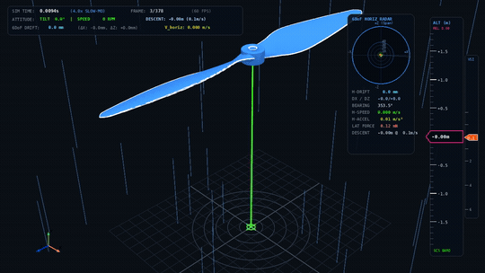
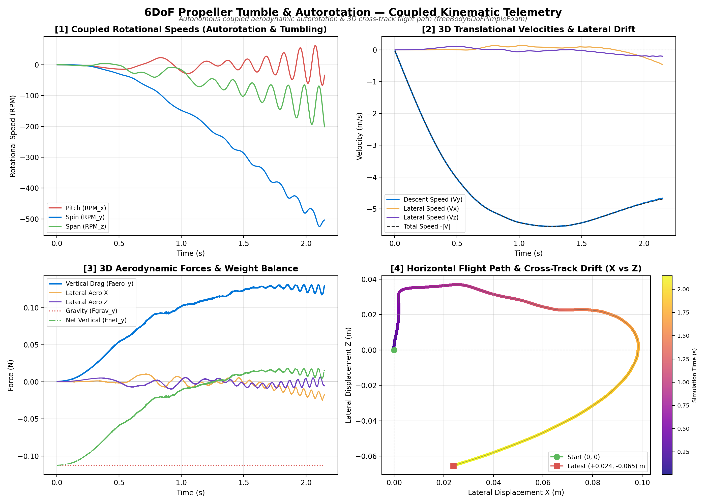
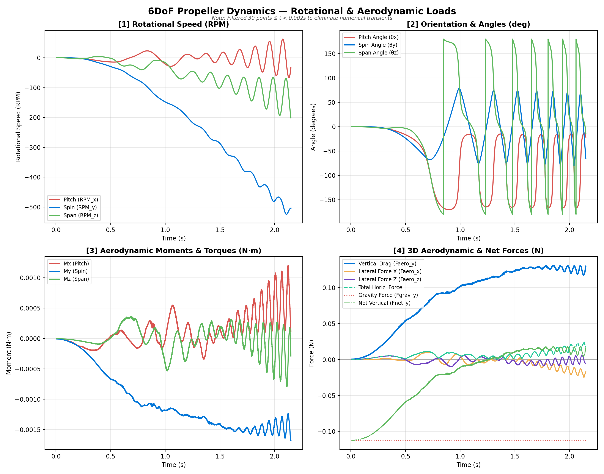
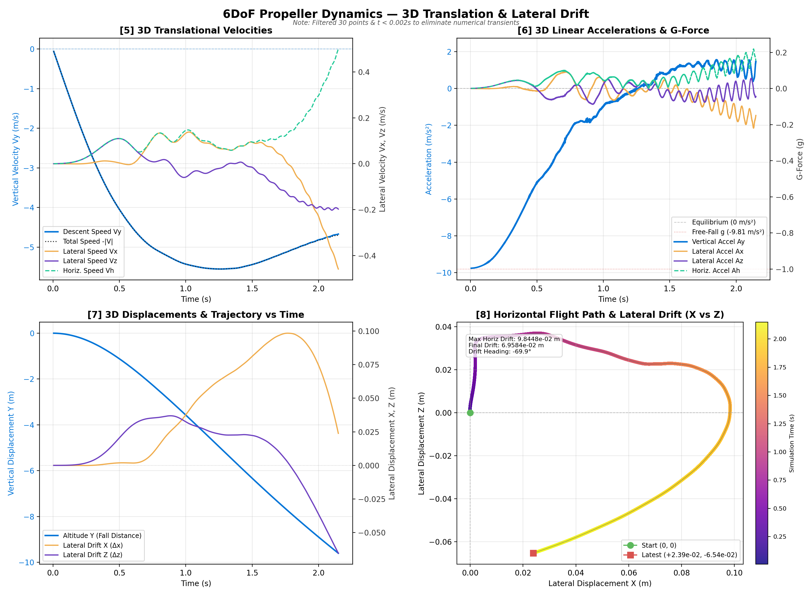

# freeBodyFoam

[](https://www.openfoam.com)
[](LICENSE)
[](docs/validation.md)

`freeBodyFoam` is a custom OpenFOAM solver suite for simulating free-falling bodies, projectile trajectories, atmospheric entry, and 6DoF tumbling dynamics in a **body-fixed accelerating reference frame**. By solving fluid dynamics in the non-inertial frame of the falling object, trajectory descents across kilometers of physical altitude are resolved within a compact, stationary computational domain.

> **Status (ASME V&V 20)**: **Code Verification Complete (Incompressible 6DoF) | Validation Partial**.  
> Incompressible 6DoF kinematics and non-inertial frame coupling ($F_{\text{aero}} \approx mg$) are verified. Tumbling autorotation kinematics are dynamically consistent ($St \approx 0.0598$, reflecting proportional $\sim 16\%$ scaling in both velocity and frequency). Terminal settling velocity against the [Tinklenberg et al. (2023)](https://doi.org/10.1017/jfm.2023.209) experimental benchmark exhibits an unresolved **$-17\%$ velocity deficit ($1.02\text{ m/s}$ vs. $1.23\text{ m/s}$, $|E| \approx 11.2\, u_{\text{val}}$)** which remains an open modeling discrepancy. Compressible solvers are experimental with zero verification cases executed.

### Claims-to-Evidence Summary

| Area | Headline result | Status |
| :--- | :--- | :--- |
| 6DoF rotational integrator | RK4 order p = 3.991; invariant drift < 1e-14 in vacuum | Verified (ω only) |
| Non-inertial frame coupling | F_aero/mg = 99.97 % at terminal state | Verified (frame only, not drag) |
| Sliding cyclicAMI | Interface flux leak < 4.8e-13 m³/s | Verified |
| Numerical uncertainty | 3-mesh GCI; u_num ≤ 0.93 % (Re = 100) | Bounded (u_num ≤ 0.93 %) |
| Tumbling kinematics | St = 0.0598 (exp. 0.055–0.060) | Consistent (St match) |
| Terminal settling velocity | −17 % vs. Tinklenberg et al. (2023) | Not validated |
| Compressible solvers | No validation cases run | Experimental (unvalidated) |

Full evidence, numerical parameters, and open discrepancies are detailed in
[docs/validation.md](docs/validation.md#1-validation-status--asme-v-v-20-overview).

---

## Solvers Overview

| Solver | Flow Regime | Reference Frame | Kinematic Degrees of Freedom | Status & Verification |
| :--- | :--- | :--- | :--- | :--- |
| **`freeBodyPimpleFoam`** | Incompressible | Body-Fixed Dynamic | 3D Translation | Verified (Frame momentum coupling) |
| **`freeBody6DoFPimpleFoam`** | Incompressible | Body-Fixed Dynamic | 6DoF (3D Translation + 3D Rotation) | Verified (Kinematics & sliding AMI) |
| **`freeBodyRhoPimpleFoam`** | Compressible | Body-Fixed Dynamic | 3D Translation | Experimental (Zero test cases run) |
| **`freeBodyRhoCentralFoam`** | Transonic / Supersonic | Body-Fixed Dynamic | 3D Translation | Experimental (Zero test cases run) |

---

## Technical & Physical Innovations

Traditional numerical methods for atmospheric free-fall require translating the entire mesh or running vast computational domains. `freeBodyFoam` introduces several key innovations:

1. **Body-Fixed Accelerating Reference Frame**: Incorporates the d'Alembert fictitious inertial force $\mathbf{S}_U = -\mathbf{a}_{\text{frame}}$ directly into the momentum equation:
   $$\frac{\partial \mathbf{U}}{\partial t} + \nabla \cdot (\mathbf{U} \mathbf{U}) - \nabla \cdot (\nu_{\text{eff}} \nabla \mathbf{U}) = -\frac{1}{\rho_f} \nabla p + \mathbf{g} - \mathbf{a}_{\text{frame}}$$
2. **Hydrostatic-Reduced Pressure Formulation ($p_{\text{rgh}}$)**: Eliminates apparent hydrostatic moments during tumbling, preserving numerical stability. (Omits hydrostatic buoyancy, which is negligible in air ($\approx 0.09\%$) but represents $\approx 3.8\%$ of weight in dense liquid; valid when center of buoyancy aligns with rotation hub).
3. **Dynamic Inflow/Outflow Switching (`fallingInletVelocity`)**: Evaluates instantaneous directional face fluxes $(\mathbf{S}_f \cdot \mathbf{U}_{\text{inlet}})$, imposing Dirichlet inflow conditions on upstream faces and reflection-free zero-gradient Neumann conditions on downstream wake faces.
4. **Coupled 6DoF Quaternion Kinematics**: Integrates Euler's rigid-body equations for angular velocity $\boldsymbol{\omega}$ with explicit RK4 ($p = 3.991$) and orientation via exponential quaternion map on $SO(3)$. Truncation-level drift is $< 10^{-14}$ across 13,333 steps at $\Delta t = 1.5 \times 10^{-5}\text{ s}$ in vacuum (scaling as $\mathcal{O}(\Delta t^4)$; RK4 is explicit and non-symplectic).
5. **Arbitrary Mesh Interface (`cyclicAMI`) for Arbitrary 3D Tumble**: Combines an inner rotating spherical mesh zone (`rotatingZone`) with an outer stationary domain, allowing continuous, unconstrained 3D tumbling without remeshing.

---

## Benchmark Showcases & Validation

### 1. Non-Inertial Reference Frame Coupling (`theRodDrop`)
A heavy half-cylinder ($R = 2.0\text{ m}$, span $w = 1.0\text{ m}$, frontal half-area $A = 2.0\text{ m}^2$, $m = 98,018\text{ kg}$ representing full solid steel cylinder volume $\pi R^2 w = 12.566\text{ m}^3$ in half-symmetry) falling through scaled dense fluid ($\rho_f = 300\text{ kg/m}^3$, $\nu = 1.5 \times 10^{-5}\text{ m}^2\text{/s}$, $g = 9.81\text{ m/s}^2$) is benchmarked for dynamic frame momentum balance under $k\text{--}\omega$ SST URANS ($Re = 2.57 \times 10^7$):
* **Analytical Formulation**: Terminal balance $F_{\text{aero}} \approx mg \implies V_{t,\text{analytical}} = \sqrt{\frac{2mg}{\rho_f C_D A}} = 96.359\text{ m/s} \approx 96.36\text{ m/s}$ (using simulated $C_D = 0.3452$).
* **Simulated Velocity**: $V_{\text{sim}} = 96.340\text{ m/s}$ (**$-0.02\%$ relative discrepancy**).
* **Terminal Equilibrium**: $\frac{dV}{dt} = 0.0031\text{ m/s}^2$ ($99.968\%$ decay toward equilibrium; near-terminal force balance $F_{\text{aero}}/mg = 99.97\%$).
* **Scope & Limitation**: Verifies non-inertial accelerating reference frame coupling ($F \approx mg$). Does not validate aerodynamic drag coefficients because $C_D$ was extracted from the simulation itself (circular verification). Buoyancy ($\approx 3.8\%$ of weight at $\rho_f = 300\text{ kg/m}^3$) is omitted because $p_{\text{rgh}}$ is integrated.

<p align="center">
  
</p>

### 2. Viscous Disk Flow ([Fernandes et al. 2007](https://doi.org/10.1017/S0022112006003685))
* **Status**: Partial (rectilinear regime only; $Re_c$ and oscillations not tested).
* **Validation Scope**: Rectilinear wake development and dynamic release were tested with rotation locked at $Re = 100$ and $Re = 200$. Unsteady wake transitions, bifurcation thresholds ($Re_c$), and trajectory oscillations are not tested.

---

## Tutorial Suite

The repository includes three documented tutorial cases:

```
tutorials/
├── theRodDrop/     # 2D planar transverse cylinder free-fall
│                   # & analytical terminal velocity verification
├── rodRoller/      # 2D cylinder with axial Z-spin via
│                   # circular sliding cyclicAMI (O-grid)
└── steelBallRun/   # True 3D solid sphere with unconstrained
                    # 6DoF motion & 32-dot Fibonacci visual markers
```

### 3D 6DoF Showcase: `steelBallRun`
Simulates a solid steel sphere ($D = 50\text{ mm}$, $m = 0.5105\text{ kg}$) falling under planetary gravity with unrestricted 3D translation and 3D tumbling ($\vec{\omega}_0 = (10, 5, 15)\text{ rad/s}$). To observe 3D roll, pitch, and yaw in a single glance, **32 high-contrast crimson surface markers** are distributed via an equilateral Fibonacci spherical lattice:

<table>
  <tr>
    <th width="45%" style="text-align:center;">3D 6DoF Spherical Tumbling (Fibonacci Markers)</th>
    <th width="55%" style="text-align:center;">Coupled 6DoF Kinematic Telemetry</th>
  </tr>
  <tr>
    <td align="center">
      
    </td>
    <td align="center">
      
    </td>
  </tr>
</table>

* **Real-time Terminal Dashboard**: `python3 track_motion.py --watch`
* **Publication Figures**: `python3 track_motion.py --plot`
* **3D PyVista Animation & Video Export**: `python3 animate_motion.py --video steelBallRun.mp4`

---

## Advanced Capabilities Showcase: 6DoF Propeller Tumble & Autorotation

> [!NOTE]
> **Private Case Study**: The propeller aerodynamic tumble simulation demonstrated below is a private research case study showcasing the capabilities of `freeBody6DoFPimpleFoam`. While the propeller geometry and case files are kept private, the side-by-side animation and telemetry illustrate the complex multi-physics dynamics resolved by the solver.

<table>
  <tr>
    <th width="45%" style="text-align:center;">3D Radar-Tracking Flight Simulation</th>
    <th width="55%" style="text-align:center;">Coupled 6DoF Kinematic Telemetry</th>
  </tr>
  <tr>
    <td align="center">
      
    </td>
    <td align="center">
      
    </td>
  </tr>
</table>

<details>
<summary><b>Click to expand full 8-panel Rotational and Translational reports (Side-by-Side)</b></summary>
<br/>

<table>
  <tr>
    <th width="50%" style="text-align:center;">Rotational Dynamics & Aerodynamic Loads</th>
    <th width="50%" style="text-align:center;">3D Trajectory & Lateral Drift Kinematics</th>
  </tr>
  <tr>
    <td align="center">
      
    </td>
    <td align="center">
      
    </td>
  </tr>
</table>

</details>

### Capabilities Demonstrated
* **Full 6DoF Coupled Tumble & Autorotation**: Demonstrates blade autorotation, gyroscopic tumbling, pitch reversal, and 3D crosswind drift on non-trivial geometries.
* **Non-Deforming Sliding Spherical Mesh (`cyclicAMI`)**: Demonstrates continuous, unrestricted multi-axis 3D tumbling without mesh skewness degradation or remeshing penalties.
* **Pressure & Viscous Moment Integration**: Demonstrates integration of instantaneous $p_{\text{rgh}}$ and viscous shear stress across complex lifting surfaces.
* **Precision Telemetry & Radar Tracking**: Demonstrates real-time 6DoF pose quaternions, Euler attitude angles, velocity, acceleration, and force balances.

## Requirements and Environment

* **OpenFOAM**: Tested on OpenFOAM v2412 (Ubuntu 24.04 LTS x86_64, GCC 13.3).
* **Python**: Python 3.8+ with NumPy, Matplotlib, and PyVista (for live telemetry, publication figures, and 3D video renders).

---

## Build Instructions

Source your OpenFOAM installation and compile with `./Allwmake`:

```bash
# Source OpenFOAM environment
source /usr/lib/openfoam/openfoam2412/etc/bashrc

# Compile boundary conditions, motion solvers, function objects, and solvers
./Allwmake
```

Compiled libraries (`libfallingInletVelocity.so`, `libfreeBodyRotationalMotion.so`) are placed into `$FOAM_USER_LIBBIN`. Solver binaries (`freeBodyPimpleFoam`, `freeBody6DoFPimpleFoam`, etc.) are installed into `$FOAM_USER_APPBIN`. To clean build artifacts, run `./Allwclean`.

---

## Quick Start: Running Tutorials

Navigate to any tutorial and launch the automated runner:

```bash
# 1. Run theRodDrop (frame coupling verification)
cd tutorials/theRodDrop/theRodDrop
./Allrun

# 2. Run rodRoller (2D transverse cylinder with axial spin)
cd tutorials/rodRoller
./Allrun

# 3. Run steelBallRun (true 3D 6DoF steel sphere)
cd tutorials/steelBallRun
./Allrun
```

---

## Documentation Index

Detailed reference documentation is maintained in the [`docs/`](docs/) directory:

| Document | Description |
| :--- | :--- |
| [`docs/models.md`](docs/models.md) | Governing equations, accelerating reference frame transformations, $p_{\text{rgh}}$ derivation, and 6DoF quaternion dynamics |
| [`docs/dictionary.md`](docs/dictionary.md) | Keyword reference tables, physical units, and minimal working templates for `fallingFrameDict` and `dynamicMeshDict` |
| [`docs/tutorials.md`](docs/tutorials.md) | Walkthrough, meshing topologies, and kinematics plots for `theRodDrop`, `rodRoller`, and `steelBallRun` |
| [`docs/validation.md`](docs/validation.md) | Verification hierarchy, ASME V&V 20 convergence data, analytical terminal velocity comparisons, and Fernandes (2007) benchmarks |
| [`docs/development.md`](docs/development.md) | Source tree breakdown, PIMPLE predictor-corrector sequence, and instructions for developer extensions |

---

## References

* **Clift, R., Grace, J. R., & Weber, M. E.** (1978). *Bubbles, Drops, and Particles*. Academic Press, New York.
* **Fernandes, P. C., Risso, F., Ern, P., & Magnaudet, J.** (2007). "Oscillatory motion and wake instability of freely rising axisymmetric bodies". *Journal of Fluid Mechanics*, 573: 479–502.
* **Jenny, M., Dušek, J., & Bouchet, G.** (2004). "Instabilities and transition of a sphere freely falling or ascending in a fluid". *Journal of Fluid Mechanics*, 508: 201–239.
* **Kurganov, A., & Tadmor, E.** (2000). "New High-Resolution Central Schemes for Nonlinear Conservation Laws and Convection-Diffusion Equations". *Journal of Computational Physics*, 160(1): 241–282.
* **Roache, P. J.** (1998). *Verification and Validation in Computational Science and Engineering*. Hermosa Publishers, Albuquerque, NM.
* **Roos, F. W., & Willmarth, W. W.** (1971). "Some experimental results on sphere and disk drag". *AIAA Journal*, 9(2): 285–291.
* **Schiller, L., & Naumann, A.** (1933). "A drag coefficient correlation". *VDI Zeitung*, 77: 318–320.
* **Shenoy, A. V., & Kleinstreuer, C.** (2008). "Flow over a thin circular disk at low-to-moderate Reynolds numbers". *Journal of Fluid Mechanics*, 605: 253–262.
* **Tinklenberg, A., Guala, M., & Coletti, F.** (2023). "Thin disks falling in air". *Journal of Fluid Mechanics*, 962: A3.
* **Uhlmann, M., & Dušek, J.** (2014). "The motion of a single heavy sphere in ambient fluid: A benchmark for interface-resolved simulation". *International Journal of Multiphase Flow*, 59: 221–243.
* **ASME V&V 20-2009**: *Standard for Verification and Validation in Computational Fluid Dynamics and Heat Transfer*. American Society of Mechanical Engineers, New York.

