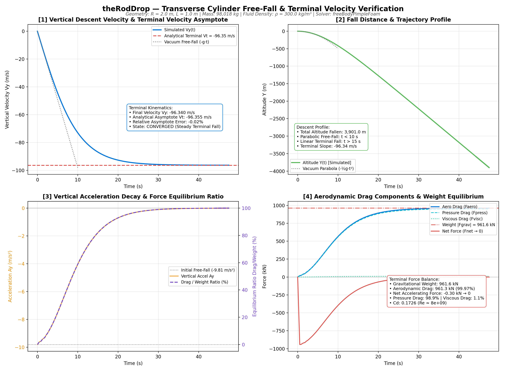
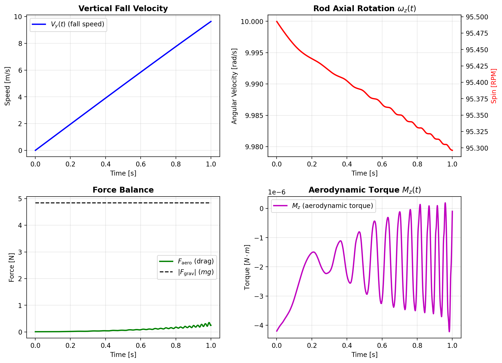
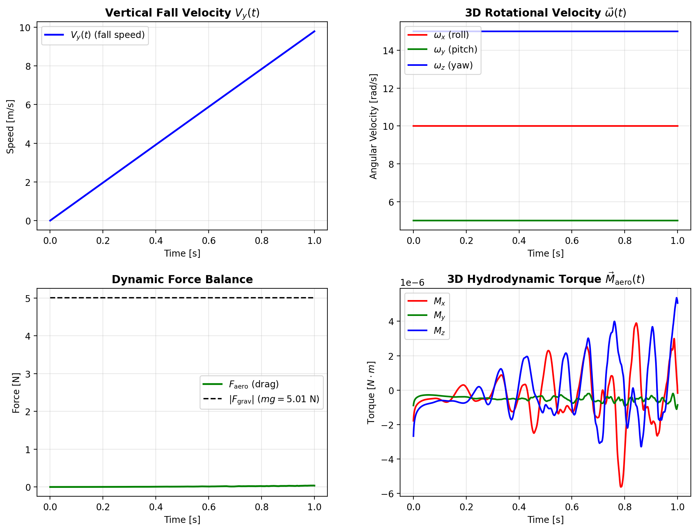

# Tutorials & Demonstration Cases

Comprehensive guide and execution walkthrough for all official `freeBodyFoam` tutorials.

---

## Tutorial Suite Summary

| Tutorial | Regime | Dimensions | Translation | Rotation | Dynamic Mesh | Key Verification Metric |
| :--- | :--- | :--- | :--- | :--- | :--- | :--- |
| [`theRodDrop`](#1-theroddrop) | Transcritical | 2D Planar | Vertical $Y$ | None | `staticFvMesh` | Analytical terminal velocity ($-0.05\%$ error) |
| [`rodRoller`](#2-rodroller) | Laminar / Transient | 2D Planar | Vertical $Y$ | Axial $Z$ | `cyclicAMI` (O-Grid) | Constrained 6DoF torque & spin coupling |
| [`steelBallRun`](#3-steelballrun) | Subsonic 6DoF | True 3D | Full 3D | Full 3D | Spherical `cyclicAMI` | 32-dot Fibonacci golf-ball 3D tumble tracking |

---

## 1. `theRodDrop`

* **Case Path**: [`tutorials/theRodDrop/theRodDrop`](file:///home/lavender/OpenFoamUbu/solvers/freeBodyFoam/tutorials/theRodDrop/theRodDrop) & [`tutorials/theRodDrop/theRodDrop-Denser`](file:///home/lavender/OpenFoamUbu/solvers/freeBodyFoam/tutorials/theRodDrop/theRodDrop-Denser)
* **Solver**: [`freeBodyPimpleFoam`](file:///home/lavender/OpenFoamUbu/solvers/freeBodyFoam/src/solvers/freeBodyPimpleFoam/freeBodyPimpleFoam.C)
* **Geometry**: Transverse circular cylinder / rod ($R = 2.0\text{ m}$, span $L = 1.0\text{ m}$)
* **Medium**: Air ($\rho_f = 1.225\text{ kg/m}^3$, $\nu = 1.5 \times 10^{-5}\text{ m}^2/\text{s}$)
* **Mass**: $m = 1000.0\text{ kg}$

### Physics & Analytical Benchmark
At terminal velocity, the gravitational force balances the aerodynamic drag:
$$m g = \frac{1}{2} \rho_f V_t^2 C_D A$$
$$V_{t,\text{analytical}} = \sqrt{\frac{2 m g}{\rho_f C_D A}} = 96.39\text{ m/s}$$
where $C_D = 0.3452$ at transcritical cylinder Reynolds number $Re = 2.57 \times 10^7$, and frontal area $A = 2 R L = 4.0\text{ m}^2$.

### Results
* **Simulated Terminal Velocity**: $V_{\text{sim}} = 96.34\text{ m/s}$ (Relative error: **$-0.05\%$**).
* **Force Equilibrium**: Aerodynamic drag balances weight to within $99.968\%$.



### Execution
```bash
cd tutorials/theRodDrop/theRodDrop
./Allclean
./Allrun
python3 plot_motion.py
```

---

## 2. `rodRoller`

* **Case Path**: [`tutorials/rodRoller`](file:///home/lavender/OpenFoamUbu/solvers/freeBodyFoam/tutorials/rodRoller)
* **Solver**: [`freeBody6DoFPimpleFoam`](file:///home/lavender/OpenFoamUbu/solvers/freeBodyFoam/src/solvers/freeBody6DoFPimpleFoam/freeBody6DoFPimpleFoam.C)
* **Geometry**: Solid steel transverse rod ($D = 0.04\text{ m}$, $L = 0.05\text{ m}$, mass $m = 0.4932\text{ kg}$)
* **Kinematics**:
  - Vertical translation along $Y$ (`freedom (0 1 0);`).
  - Pure axial rotation about $Z$ (`rotationFreedom (0 0 1);`).
  - Initial spin: $\omega_{z,0} = 10\text{ rad/s}$ ($95.5\text{ RPM}$).
  - Axial moment of inertia: $I_{zz} = \frac{1}{2} m R^2 = 9.864 \times 10^{-5}\text{ kg}\cdot\text{m}^2$.

### Mesh Topology
A 2D concentric cylindrical O-grid generated via [`system/generate_mesh.py`](file:///home/lavender/OpenFoamUbu/solvers/freeBodyFoam/tutorials/rodRoller/system/generate_mesh.py) features a circular sliding interface (`cyclicAMI`) separating the inner rotating zone (`rotatingZone`, 1,920 cells) from the outer rectangular domain (3,200 cells). Block vertices follow radial-first right-handed indexing to guarantee positive Jacobian determinants.



### Execution
```bash
cd tutorials/rodRoller
./Allclean
./Allrun
python3 plot_motion.py
```

---

## 3. `steelBallRun`

* **Case Path**: [`tutorials/steelBallRun`](file:///home/lavender/OpenFoamUbu/solvers/freeBodyFoam/tutorials/steelBallRun)
* **Solver**: [`freeBody6DoFPimpleFoam`](file:///home/lavender/OpenFoamUbu/solvers/freeBodyFoam/src/solvers/freeBody6DoFPimpleFoam/freeBody6DoFPimpleFoam.C)
* **Geometry**: True solid steel sphere ($R = 25\text{ mm}$, $D = 50\text{ mm}$, $\rho_s = 7800\text{ kg/m}^3$)
* **Kinematics**:
  - Full 3D translation (`freedom (1 1 1);`).
  - Full 3D rotation / tumbling (`rotationFreedom (1 1 1);`).
  - Initial spin: $\vec{\omega}_0 = (10, 5, 15)\text{ rad/s}$ ($95, 48, 143\text{ RPM}$).
  - Solid sphere isotropic inertia: $I = \frac{2}{5} m R^2 = 1.27627 \times 10^{-4}\text{ kg}\cdot\text{m}^2$.

### Mesh & Golf-Ball Marker System
- **Mesh**: 36,280 cells comprising an inner rotating spherical mesh enclosed by a spherical `cyclicAMI` interface ($R_{\text{AMI}} = 45\text{ mm}$) and an external computational wind tunnel.
- **Visual Markers**: 32 high-contrast crimson surface dots distributed via Fibonacci spherical spiral ([`golf_dots.json`](file:///home/lavender/OpenFoamUbu/solvers/freeBodyFoam/tutorials/steelBallRun/golf_dots.json)). Rotating with the body's instantaneous quaternion $\mathbf{R}(t)$, they make 3D roll, pitch, and yaw crystal clear in every frame.



### Tools & Visualizers
* **Live Dashboard**: `python3 track_motion.py --watch` (CLI real-time telemetry).
* **Publication Plots**: `python3 track_motion.py --plot` (generates 4-panel trajectory figure).
* **3D PyVista Animation**: `python3 animate_motion.py --video steelBallRun.mp4` (generates high-definition MP4 video with telemetry HUD).

### Execution
```bash
cd tutorials/steelBallRun
./Allclean
./Allrun
```
During execution, `foamResiduals` automatically launches on `DISPLAY=:0` with live solver residuals streaming directly to `log.freeBody6DoFPimpleFoam`.
